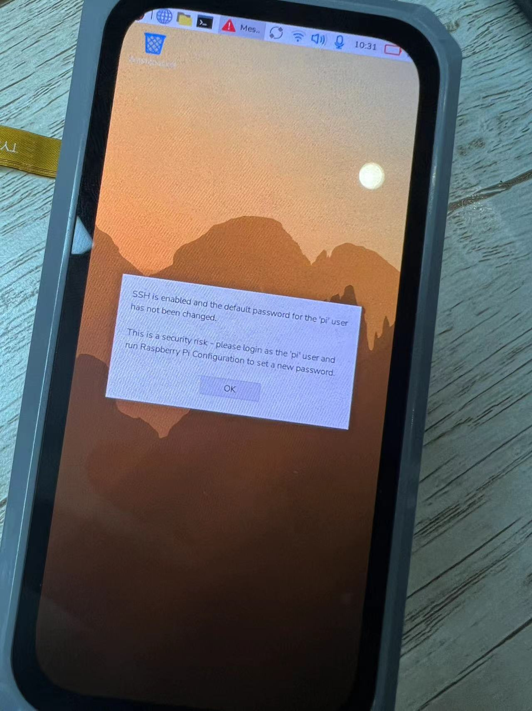

<h1 align="center">T-Display-CM0</h1>

<p align="center">
  
</p>

<p align="center">
  <a href="README_CN.md">简体中文</a> | <strong>English</strong>
</p>

T-Display-CM0 is a Linux smart terminal development project based on the **CM0_Lite** carrier board. It features an AMOLED touchscreen and supports optional camera, audio, LoRa, battery, keyboard, GNSS, LTE-M, and temperature and humidity modules.

This repository provides Raspberry Pi OS deployment resources, first-boot scripts, an LVGL desktop application, Linux drivers, Device Tree Overlays, and hardware documentation.

> [!IMPORTANT]
> For first-time setup, follow the [Quick Start](#quick-start) steps in order. The board installs its drivers and applications automatically during the first boot and may restart several times. Do not disconnect power during this process.

## Contents

- [Overview](#overview)
- [Repository Layout](#repository-layout)
- [Quick Start](#quick-start)
- [Basic Operation](#basic-operation)
- [Functional Tests](#functional-tests)
- [Switching Desktop Mode](#switching-desktop-mode)
- [Troubleshooting](#troubleshooting)
- [Development](#development)
- [Resources](#resources)

## Overview

### Main Features

| Function | Chip / Interface | Description |
| --- | --- | --- |
| AMOLED display | RM69A10, MIPI DSI | 568 x 1232 resolution |
| Capacitive touch | Goodix GT9895, I2C | Multi-touch input |
| Camera | CSI-2 | Preview through the Camera app |
| Audio | ES8388 / ES8389, I2S | Headphones and expansion-board speaker |
| LoRa | LR2021, SPI | Data transmission and reception |
| Battery | BQ25890 / BQ25896, BQ27220 | Charging, discharging, and battery monitoring |
| IMU | QMI8658C, I2C | Acceleration, angular velocity, and temperature |
| Keyboard | TCA8418 | 7 x 10 keyboard matrix |
| Temperature and humidity | AHT20, I2C | Temperature and humidity display |
| GNSS | Expansion module | Position, coordinates, and UTC time |
| Cellular | LTE-M expansion module | SIM information and UTC time |

### Power and Buttons

- Both Type-C ports support 5 V power input.
- Press the power button for about 1 second to turn the board on.
- Hold the power button for about 3 seconds to turn the board off.
- During normal startup, the green onboard LED turns on and the blue LED flashes.
- If the display or touch input becomes unresponsive, press the lower side `RST` button to restart the board.

## Repository Layout

```text
T-Display-CM0/
├── deploy/
│   ├── cm0_resource_collect/     # First-boot and automatic deployment files
│   ├── desktop_alt/              # LVGL / Raspberry Pi desktop selection
│   ├── rasp_img/                 # Raspberry Pi OS image download information
│   └── T-Display-CM0...pdf       # Chinese user manual
├── src/
│   ├── app/                      # Desktop application and peripheral examples
│   ├── cmo_drivers/              # Linux kernel drivers
│   └── dts/                      # Device Tree Overlay sources
├── image/                        # README images
├── datasheet/                    # Product datasheets
├── schematic/                    # Schematics
├── LICENSE
└── README.md
```

## Quick Start

### 1. Requirements

Prepare the following:

- T-Display-CM0 board, display, and any required expansion modules
- TF card and card reader
- USB to Type-C cable with data support
- Windows PC
- [Rufus](https://rufus.ie/downloads/)
- [Raspberry Pi OS 32-bit image](https://downloads.raspberrypi.com/raspios_armhf/images/raspios_armhf-2025-10-02/2025-10-01-raspios-trixie-armhf.img.xz)

The deployment package is prepared for `2025-10-01-raspios-trixie-armhf.img.xz`. Prebuilt drivers and applications may not be compatible with a different OS release.

### 2. Select the Desktop Mode

The deployment package uses the **LVGL desktop by default; it is currently for internal testing only**. Select Raspberry Pi Desktop for normal desktop use.

| Mode | Purpose | First-boot script |
| --- | --- | --- |
| LVGL | Currently for internal testing only; default deployment option | `deploy/desktop_alt/desktop_lvgl/firstrun.sh` |
| Raspberry Pi Desktop | Standard Raspberry Pi graphical desktop | `deploy/desktop_alt/desktop_raspberry/firstrun.sh` |

To change the mode before flashing, copy the selected `firstrun.sh` into `deploy/cm0_resource_collect/` and overwrite the file with the same name.

### 3. Flash the System Image

1. Insert the TF card into the PC and start Rufus.
2. Select the TF card under **Device**.
3. Click **SELECT** and open `2025-10-01-raspios-trixie-armhf.img.xz`.
4. Click **START**, confirm the write operation, and wait for it to finish.
5. When Rufus reports **READY**, **do not remove the TF card yet**. The `bootfs` partition is required in the next step.

> [!WARNING]
> Rufus erases all data on the selected storage device. Confirm that the selected device is the TF card, not a computer drive or another removable device.

### 4. Deploy the T-Display-CM0 Resources

Open the following repository directory:

```text
deploy/cm0_resource_collect/
```

Copy **all files and folders** from this directory to the root of the TF card's `bootfs` partition. It should contain at least:

```text
bootfs/
├── lilygo_resources/
├── append_firstrun_to_cmdline.bat
├── config.txt
├── firstrun.sh
└── firstrun.txt
```

If Windows reports that files already exist, overwrite them with the files from the deployment package.

After copying, double-click the following file in `bootfs`:

```text
append_firstrun_to_cmdline.bat
```

The command window may appear only briefly. This is expected. The script appends the first-boot arguments to `cmdline.txt`. After running it, confirm that `cmdline.txt`, `firstrun.sh`, and `lilygo_resources` are still present in `bootfs`.

### 5. First Boot

1. Safely eject the TF card from Windows.
2. Insert the TF card into the T-Display-CM0.
3. Confirm that the display, camera, and expansion modules are connected correctly.
4. Connect a 5 V power supply through a Type-C cable.
5. Press the power button for about 1 second.
6. When the green LED turns on and the blue LED starts flashing, wait for automatic initialization to finish.

Initial setup normally takes about **2–3 minutes**. The board creates the user account, enables SSH, installs drivers and Overlays, deploys applications and services, and restarts automatically. Do not remove the TF card or disconnect power during this process.

Default login:

| Item | Default |
| --- | --- |
| Username | `pi` |
| Password | `raspberry` |
| SSH | Enabled automatically during first-time deployment |

Run `passwd` after the first login to change the default password.

Initialization is complete when one of the following occurs:

- The T-Display-CM0 LVGL application desktop, currently for internal testing only, opens.
- The graphical desktop opens in Raspberry Pi Desktop mode.
- A login prompt appears on the serial console.

## Basic Operation

| Operation | Method |
| --- | --- |
| Power on | Press the power button for about 1 second |
| Power off | Hold the power button for about 3 seconds |
| Reset | Press the lower side `RST` button |
| Power input | Connect 5 V to either Type-C port |
| Serial debugging | Connect to the onboard serial port to monitor first-boot logs |

## Functional Tests

### Camera

Tap the **Camera** icon. The app opens the upper CSI-2 camera and displays a live preview.

### Music

Connect headphones or an expansion board with a speaker. Open **Music** and tap the play button to play the test audio.

### LoRa

The LoRa transmit and receive test requires at least two boards:

1. Open **LoRa** on the first board and tap **Send** to transmit data periodically.
2. Open **LoRa** on the second board and tap **Receive** to receive data periodically.
3. Compare the continuously updated data on both boards. Matching transmitted and received data indicates successful LoRa communication.

To restart transmission or reception, exit the LoRa app and open it again.

### Battery

Install two 21700 batteries correctly on the expansion board and turn on the battery switch. Open **Battery** to view charging and discharging voltage, current, charge level, and status.

### Weather

Connect the AHT20 temperature and humidity sensor on the expansion board. Open **Weather** to view the current temperature and humidity.

### Keyboard

Install the keyboard expansion board correctly and open **Keyboard**:

- `Shift + character`: enter uppercase or shifted characters
- `Caps Lock`: enable or disable uppercase lock
- `Fn + F4` / `Fn + F5`: control the keyboard backlight

### GNSS

Use the board outdoors or in an open area. Open **GNSS** and tap **Locate**. The initial position fix takes approximately 120 seconds. When complete, the app displays latitude, longitude, and satellite UTC time.

### Cellular

Insert an IoT SIM card with an active LTE-M service and open **Cellular**. The app displays the information read from the SIM and synchronizes UTC time.

## Switching Desktop Mode

Select the desktop mode before flashing and performing first-time deployment.

To use Raspberry Pi Desktop:

```text
Copy deploy/desktop_alt/desktop_raspberry/firstrun.sh
to deploy/cm0_resource_collect/firstrun.sh and overwrite it.
```

To switch back to the LVGL desktop, which is currently for internal testing only:

```text
Copy deploy/desktop_alt/desktop_lvgl/firstrun.sh
to deploy/cm0_resource_collect/firstrun.sh and overwrite it.
```

After replacing the script, repeat the complete flashing and first-boot procedure.

## Troubleshooting

### No Display After First Boot

1. Wait at least 3 minutes. The board may restart automatically during first-time deployment.
2. Check that the green LED is on and the blue LED is flashing.
3. Confirm that all contents of `cm0_resource_collect` were copied to the `bootfs` root.
4. Confirm that `append_firstrun_to_cmdline.bat` was executed.
5. Check the display cable, TF card, and 5 V power supply.
6. Connect the serial console and inspect the boot log.

First-boot logs are normally stored at:

```text
/boot/firmware/firstrun-lilygo.log
/boot/firmware/lilygo_resources/install_lilygo_cm0_lite.log
```

You can also run:

```bash
journalctl -u lilygo-firstboot-install.service
```

### Display Corruption or Unresponsive Touch

Press the lower side `RST` button. If the issue remains, disconnect power, check the display and touch cables, and power the board on again.

### Unable to Log In Through SSH

Confirm that first-time initialization has completed, then use the default `pi` / `raspberry` credentials. Make sure the board and computer are on the same network. Use the serial console or router interface to find the board's IP address.

### `Invalid module format`

Prebuilt `.ko` files must match the Linux kernel version and configuration. If the OS image or kernel has been changed, rebuild the drivers against the corresponding kernel source.

## Development

Regular users only need `deploy/cm0_resource_collect` and do not need to compile the kernel manually.

### LVGL Desktop Application

The desktop application source is in `src/app/sample_display/` and builds `sample_display.out`. Cross-compilation requires a 32-bit ARM toolchain and a sysroot matching the target OS:

```bash
sudo apt install gcc-arm-linux-gnueabihf g++-arm-linux-gnueabihf make
make -C src/app/sample_display RPI_SYSROOT=/path/to/rpi_sysroot
```

After building, update the deployed binary at:

```text
deploy/cm0_resource_collect/lilygo_resources/app/lilygo_desktop_app/sample_display.out
```

### Peripheral Examples

- `src/app/sample_aht20/` reads an AHT20 through `/dev/i2c-1`.
- `src/app/sample_lora/` accesses an LR2021 through `/dev/spidev0.0` and GPIO.

### Kernel Drivers and Device Tree

- Kernel driver sources: `src/cmo_drivers/`
- Overlay sources: `src/dts/`
- Deployed modules: `deploy/cm0_resource_collect/lilygo_resources/drivers/`
- Deployed Overlays: `deploy/cm0_resource_collect/lilygo_resources/dtbo/`

Each driver directory contains its own `Makefile`. Set `KDIR` to Linux kernel sources that exactly match the target system and build with the `arm-linux-gnueabihf-` toolchain. The prebuilt modules in this repository are only intended for their corresponding OS image.

## Resources

- [T-Display-CM0 Chinese User Manual](<./deploy/T-Display-CM0(SKU：)使用说明书_V1.0.pdf>)
- [CM0 + CM0-KIT Chinese Datasheet](./datasheet/CM0+cm0-KIT中文规格书.pdf)
- [T-Display-CM0 Schematic](./schematic/T-DIsplay-CM0-V0.3-20260818.pdf)
- [Raspberry Pi OS Image Download Information](./deploy/rasp_img/README_en)

## Contributing

Issues and pull requests for hardware support, driver fixes, and example applications are welcome. When reporting a problem, include the board revision, OS image, `uname -a` output, relevant logs, and reproduction steps.

## License

The repository root is licensed under the [MIT License](LICENSE). Some Linux kernel driver files contain their own SPDX identifiers, copyright notices, or GPL module licenses. Those file-specific notices take precedence.
